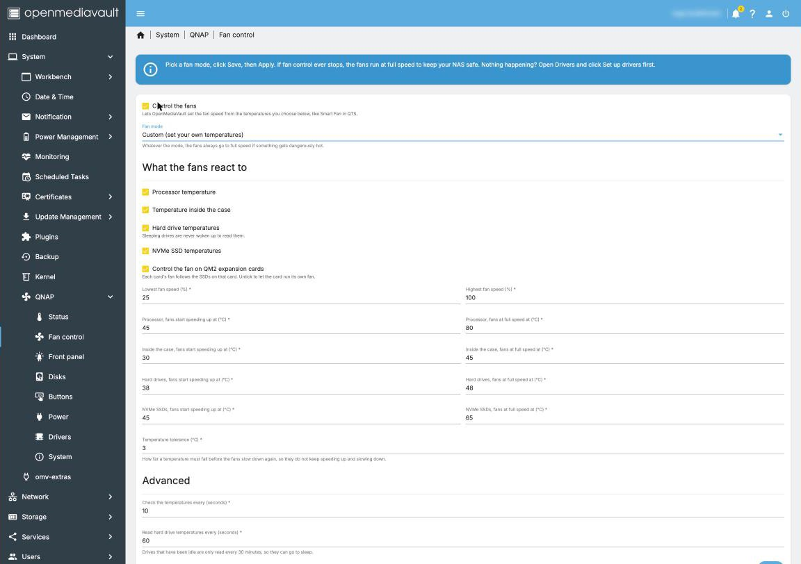
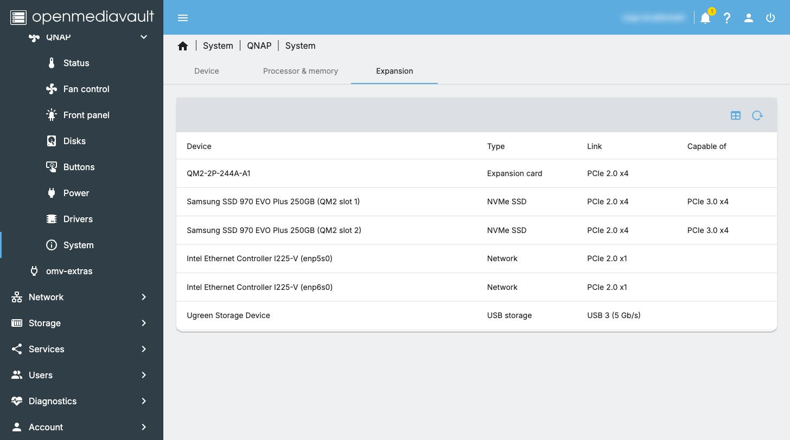
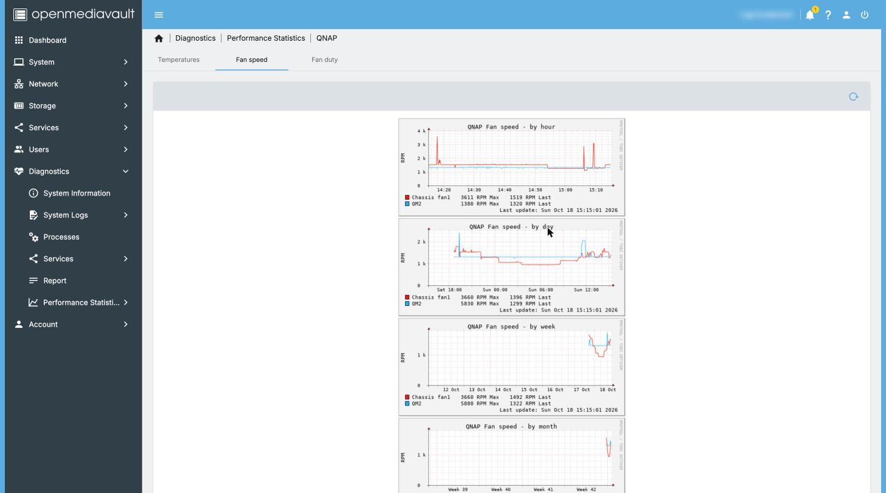
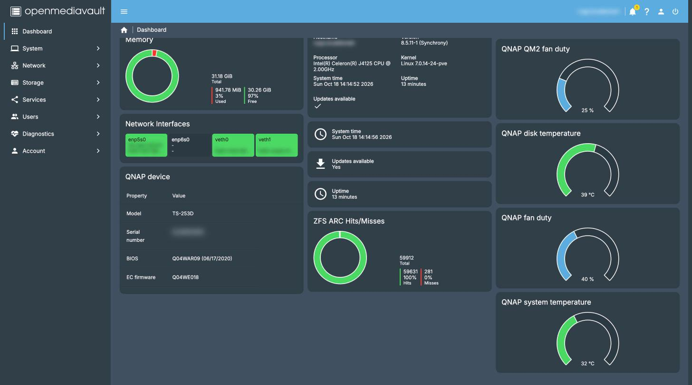
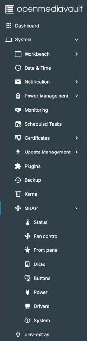

# openmediavault-qnap: QNAP fan control, LEDs and buttons for OpenMediaVault

**Leaving QNAP QTS? This free plugin makes your QNAP NAS hardware work
properly in [OpenMediaVault](https://www.openmediavault.org/) (OMV).**

When you replace QTS with a normal Linux NAS system such as
OpenMediaVault, the QNAP hardware doesn't know what to do. The fans
often run at full speed and are loud, or never speed up at all. The
status and disk lights stay off or show the wrong thing, and the front
buttons do nothing.

This plugin fixes that from inside the OpenMediaVault web interface, with
no command line needed:

- ✅ **Quiet, automatic fan control** like QTS Smart Fan (Quiet, Normal,
  Performance or your own curve), based on CPU, system, hard disk and
  NVMe temperatures.
- ✅ **Working LEDs**: status light, disk bay lights, locate a disk, front
  panel brightness.
- ✅ **Buttons and beeps**: USB Copy and Reset buttons, QTS-style beeps.
- ✅ **Temperature graphs, dashboard gauges and email alerts.**
- ✅ **QM2 expansion cards** (M.2 NVMe) with their own fan and slot lights.

It is free and open source (GPL), built on the open source
[qnap8528](https://github.com/0xGiddi/qnap8528) and
[qnap-qm2](https://github.com/0xGiddi/qnap-qm2) drivers. It never uses
QNAP's own software. If anything goes wrong, the fans go to full speed so
your NAS stays cool.

> **Status: feature complete (8.0.8).** Every feature below is verified on
> the reference **TS-253D** with a QM2-2P-244A-A1 card (OMV 8.5). The
> qnap8528 driver supports many more QNAP models (TS-x51, TS-x53, TS-x64,
> TS-x73A, TVS and others), so they should work, but they have not been
> tested with this plugin yet: see [docs/hardware/models.md](docs/hardware/models.md)
> and please send a [model test report](docs/testing/model-testing.md).

## Quick start

Already running OpenMediaVault 8 on your QNAP?

1. Download **one file**, `openmediavault-qnap_<version>_all.deb`, from the
   [latest release](https://github.com/nader-eloshaiker/omv-qnap-plugin/releases/latest).
2. In the OMV web interface open **System › Plugins**, click **Upload**,
   choose the file, then select the plugin and click **Install**.
3. Open **System › QNAP › Drivers** and click **Set up drivers**. This
   installs the drivers and everything they need, and turns on fan
   control.
4. Open **System › QNAP › Status** to watch the fans and temperatures.

Still on QTS? Read **[Moving from QNAP QTS to OpenMediaVault](docs/guide/qts-to-omv.md)**:
a step-by-step guide to backing up, installing OMV on your QNAP and
setting up this plugin.

Project website: <https://nader-eloshaiker.github.io/omv-qnap-plugin/>

**Community:** see what others are saying, ask questions and share your
results in the [OMV forum thread](https://forum.openmediavault.org/index.php?thread/59641-openmediavault-qnap-fan-control-leds-and-hardware-settings-for-qnap-nas-omv-8-te/). Bugs and model test reports go to
[GitHub issues](https://github.com/nader-eloshaiker/omv-qnap-plugin/issues).

## Features

**Fan control**
- QTS-style Smart Fan: Quiet, Normal and Performance presets, a Custom
  curve (ramp-up and full-speed temperature per source, fan speed range,
  hysteresis) and Manual.
- Temperature sources: CPU (coretemp / k10temp), the embedded controller's
  system sensors, hard disks (S.M.A.R.T., sleeping disks are never woken)
  and NVMe SSDs. USB disks are ignored, since the chassis fans can't cool
  them.
- Hysteresis, CPU spike smoothing, critical-temperature override,
  fan-failure detection and PWM read-back checks.
- Fail safe: if the daemon stops or crashes, the chassis fans go to full
  speed.
- QM2 expansion cards: each card's fan follows its own M.2 slot and NVMe
  temperatures, or can be left to the card.
- Idle disks are left alone so they can spin down
  ([what else keeps disks awake](docs/disk-sleep.md)).

**LEDs**
- Status LED following system and storage health, QTS style: green when
  healthy, solid red for a fan or sensor fault or a failed or full volume,
  blinking red for a degraded pool or array or a crashed daemon,
  green/red alternating while a pool resilvers or an array rebuilds. A
  scrub doesn't change it.
- Disk bay and QM2 slot LEDs: present, activity and error (S.M.A.R.T.,
  faulted ZFS or md member).
- Locate: blink a bay's or QM2 slot's LED red for 10 minutes from the
  Disks page.
- Front panel brightness with an optional night schedule.
- USB LED feedback for USB Copy.

**Buttons and sounds**
- USB Copy runs a chosen OMV Scheduled Task; Reset held 3 seconds runs
  another. Chassis open is logged and mailed.
- Optional QTS beeps through the buzzer: at boot, every 5 minutes while a
  fan has stopped, when a pool turns degraded, failed, full or rebuilding,
  and when USB Copy fails.

**Monitoring and notifications**
- Status page (fans, duty, every temperature, storage health) and a Disks
  page (bays, QM2 slots, devices, LED state).
- Dashboard: a fans and temperatures grid, a device widget, history graphs
  and round gauges for fan duty and CPU, system, disk and NVMe
  temperatures.
- Performance graphs (Diagnostics › Performance statistics › QNAP):
  temperatures, fan speed and fan duty, by hour, day, week, month and year.
- Fault emails through OMV's own notifications ("QNAP hardware" event):
  fan, temperature, disk or pool problems that last a minute, when they
  clear, and when the daemon stops unexpectedly.

**Hardware settings and drivers**
- Power recovery after a power failure, EuP mode and the `reboot=efi`
  kernel option (QNAP x86 boxes hang on reboot without it).
- System page: model, serial number, BIOS, EC firmware, boards, QM2 cards;
  processor and memory slots; PCIe and USB devices and the speed they run at.
- The drivers come inside the plugin: **Set up drivers** on the Drivers
  page installs them with everything they need in one click, and is only
  clickable when something needs doing. Kernel updates rebuild the
  drivers automatically.

The plugin never talks to the EC from userspace and never runs QNAP
binaries: all hardware access goes through the open source drivers.

## Screenshots

From the reference TS-253D; serial numbers, host name and addresses are
blurred.

| | |
|-|-|
|  Dashboard |  Dashboard gauges |
|  System › QNAP |  Status |
|  Fan control |  Custom fan curve |
|  Front panel |  Disks |
|  Buttons |  Power |
|  Drivers |  System |
|  Temperature graphs |  Fan speed graphs |
|  Notification events |  Device widget |

 Navigation

## Requirements

- OpenMediaVault 8 (Debian 13), tested on a TS-253D. OMV 7 is not
  supported (it would need a separate 7.x release line).
- Headers for the running kernel, so DKMS can build the drivers. The
  plugin's Drivers page shows whether they are installed and installs them
  with one click (also for future kernel updates).

## Install

The [Quick start](#quick-start) above is all most people need:

1. Download `openmediavault-qnap_<version>_all.deb` from the
   [latest release](https://github.com/nader-eloshaiker/omv-qnap-plugin/releases/latest).
2. **System › Plugins › Upload**, choose the file, then **Install**.
3. **System › QNAP › Drivers › Set up drivers**: installs the
   [qnap8528](https://github.com/0xGiddi/qnap8528) and
   [qnap-qm2](https://github.com/0xGiddi/qnap-qm2) driver packages and the
   kernel headers DKMS needs, and turns on fan control.

Then, under **System › QNAP**:

- **Fan control**: pick a mode (Quiet, Normal, Performance, Custom or
  Manual), then Save and Apply.
- **Status**: watch the fan speed and temperatures live.
- **Front panel** / **Power**: status LED and brightness; power recovery,
  EuP mode and `reboot=efi`.
- **System**: model, serial number and firmware versions.

New to OpenMediaVault? See
[Moving from QNAP QTS to OpenMediaVault](docs/guide/qts-to-omv.md).

### Advanced: command line

The release also has the driver packages, built from upstream releases.
They replace a hand-made `dkms install` of the same driver. To install
all three over SSH instead:

```sh
apt install ./qnap8528-dkms_<version>_all.deb ./qm2mod-dkms_<version>_all.deb \
            ./openmediavault-qnap_<version>_all.deb
```

Then check **System › QNAP › Drivers** shows the driver as *Loaded*, tick
*Load the qnap8528 module at boot* (and *qm2mod* for QM2 cards), and
enable fan control on the **Fan control** page.

### Fail safe

When the service stops or crashes, the chassis fans go to **full speed**:
qnap8528 has no way to hand the fan back to the EC's automatic mode. QM2 card
fans go back to the card's own controller on a clean stop (full speed after
a crash), and you can leave them to the card permanently by unticking
*Control QM2 expansion card fans*.

### Disks that don't spin down

The plugin never wakes sleeping disks and lets idle ones sleep. Other
software often doesn't: OMV's S.M.A.R.T. power mode *Never*, the
`drivetemp` module, other fan or temperature tools. See
[docs/disk-sleep.md](docs/disk-sleep.md) for what to change and how to
find what wakes a disk.

### Reboot hangs

Some QNAP x86 units hang on reboot under Linux. **Power ›
Use the EFI reboot method** (on by default) adds `reboot=efi` to the kernel command line.
The plugin writes this to `/etc/default/grub.d/openmediavault-qnap.cfg` and
runs `update-grub`, so your own `/etc/default/grub` is not edited. The
change takes effect after the next reboot.

## Development

```sh
make test                      # unit tests against a fake sysfs (any OS with python3)
make docker-deb                # build dist/*.deb in Docker (macOS or any host)
make deb                       # or on a Debian 13 host with debhelper
make deploy NAS=root@NAS_HOST  # install on a test NAS over SSH
```

Documentation starts at [docs/README.md](docs/README.md): architecture,
hardware facts and measurements, fan control, LEDs, OMV integration,
dependencies, build and release, and testing on hardware and in the UI.
[docs/PLAN.md](docs/PLAN.md) has the roadmap.

Using an AI coding assistant? [AGENTS.md](AGENTS.md) routes it to the
right documents, roles and runbooks; see [docs/ai-context.md](docs/ai-context.md).

Useful on the NAS: `qnapd status`, `qnapd info`, `journalctl -u qnapd -f`.

## Credits

- [0xGiddi](https://github.com/0xGiddi) for qnap8528 and qnap-qm2
- Prior art: [omv-panq-plugin](https://github.com/Dag-Rui/omv-panq-plugin),
  [QNAP-EC](https://github.com/Stonyx/QNAP-EC),
  [QNAP_Fan_Control](https://github.com/edddeduck/QNAP_Fan_Control), and the
  [OMV forum guide](https://forum.openmediavault.org/index.php?thread/57619-qnap-temperatures-fan-control/)

Not affiliated with QNAP. Use at your own risk.

## License

GPL-3.0-or-later. See [LICENSE](LICENSE).
