# Moving from QNAP QTS to OpenMediaVault

A step-by-step guide for QNAP owners who want to replace QTS with
[OpenMediaVault](https://www.openmediavault.org/) (OMV), and keep the
things QTS did for the hardware: quiet fans, front lights, buttons, beeps
and alerts. You don't need to know Linux. Where you have to type a
command, the guide shows it and says what it does.

The guide was written on the reference TS-253D. Other x86 QNAP models
should work the same way, but menus and keys can differ a little. Where
that is the case, the guide says so.

## Contents

1. [Is this for you?](#1-is-this-for-you)
2. [Before you start: back up everything](#2-before-you-start-back-up-everything)
3. [Make the OMV installer USB stick](#3-make-the-omv-installer-usb-stick)
4. [Install OMV onto the USB SSD](#4-install-omv-onto-the-usb-ssd)
5. [First login to the OMV web page](#5-first-login-to-the-omv-web-page)
6. [Install omv-extras (optional)](#6-install-omv-extras-optional)
7. [Install the QNAP plugin](#7-install-the-qnap-plugin)
8. [Set up your storage and shares](#8-set-up-your-storage-and-shares)
9. [Day to day](#9-day-to-day)
10. [Going back to QTS](#10-going-back-to-qts)
11. [Troubleshooting](#11-troubleshooting)
12. [Getting help](#12-getting-help)

---

## 1. Is this for you?

**OpenMediaVault** is a free NAS system built on Debian Linux. It runs
file shares (Windows, Mac and Linux), backups, scheduled tasks, Docker
apps and more, all from a web page, much like QTS.

On its own, OMV doesn't know about QNAP hardware. Without help, the fans
run at a fixed speed (often loud), the front lights do nothing and the
buttons don't work. The **openmediavault-qnap** plugin fixes that:

- **Fan control** like QTS Smart Fan: Quiet, Normal, Performance, or your
  own curve, based on CPU, system, disk and NVMe temperatures.
- **Front lights**: the status light shows system health, the disk bay
  lights show activity and faults, and you can dim them at night.
- **Buttons**: USB Copy and Reset can run tasks you choose.
- **Beeps**: optional QTS-style warnings through the buzzer.
- **Alerts**: emails when a fan stops, a disk gets too hot or a pool
  has a problem.
- **QM2 expansion cards**: fan and slot lights, if you have one.

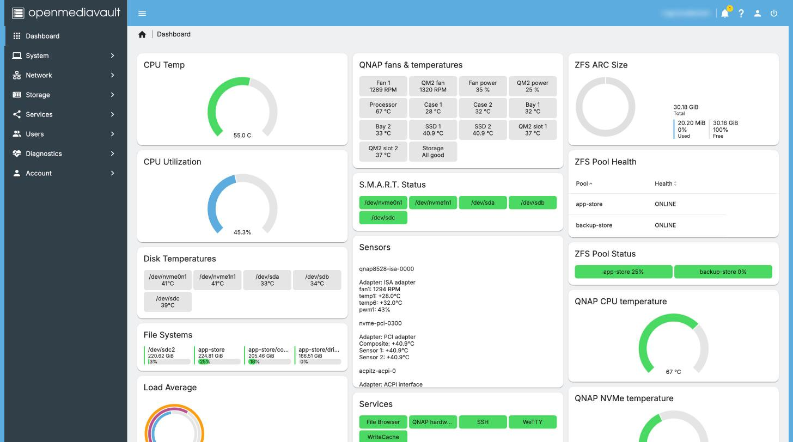

### Which QNAP models?

The plugin works on QNAP models supported by the open source
[qnap8528 driver](https://github.com/0xGiddi/qnap8528). That is the
**Intel and AMD (x86)** models with an IT8528 or similar embedded
controller, such as the TS-x53D, TS-x51, TS-x73 and TS-x77 families.
Check the driver's model list before you start. **ARM models** (for
example the TS-x28A or TS-x31 families) are not supported.

The plugin is fully tested on the reference TS-253D. Other models are
expected to work but have not been tested yet; see
[the tested models list](../hardware/models.md). If yours isn't there,
a [test report](../testing/model-testing.md) helps everyone.

### What you need

- **A USB SSD or a good USB stick, 16 GB or bigger**, for OMV itself.
  OMV is installed on this USB drive. Your internal disks stay free for
  your data. A small USB SSD (or an M.2 SSD in a USB enclosure) is much
  better than a cheap stick: cheap sticks wear out. This is how the
  reference TS-253D runs.
- **A second USB stick (2 GB or more)** for the installer. It gets wiped.
- **A USB keyboard and an HDMI monitor or TV** for the install, if your
  QNAP has an HDMI port. Some people report that Mac keyboards don't work
  in the QNAP BIOS; a plain Windows keyboard is safest.
- **A network cable** from the NAS to your router. The installer needs
  internet access.
- **Another computer** (Windows, macOS or Linux) to make the installer
  stick and to use the OMV web page.
- **Somewhere to put a copy of all your data** while you switch (see
  step 2).

No HDMI port? Some QNAP models (many TS-x73 and rack models) have none.
You can still do this, but it is harder: the usual way is to plug the USB
SSD into an ordinary PC, install OMV onto it there, then move it to the
QNAP. That is beyond this guide; ask on the forum (step 12) first.

### How long it takes

- Backing up: from an hour to a day or more, depending on how much data
  you have. This is usually the slowest part.
- Installing OMV and the plugin: about 1 to 2 hours the first time.
- Setting up shares and copying data back: an hour, plus copy time.

Plan a weekend if you have a lot of data. You can stop between steps.

---

## 2. Before you start: back up everything

**This is the most important step.** Installing OMV will not touch your
disks if you follow this guide, but you will need to **erase the data
disks** to use them in OMV.

Why you can't just keep your QTS storage pool:

- QTS builds its storage pools in its own way (with extra QNAP layers on
  top of standard Linux pieces). OMV can't safely take over a QTS storage
  pool, and you shouldn't rely on it. Experts sometimes manage to read
  one, but don't plan your move around that.
- QuTS hero pools use a QNAP version of ZFS that OMV can't import.

So the plan is: **copy your data off, switch to OMV, set up new storage,
copy the data back.**

1. List what you have: shared folders, how big each one is, and who uses
   them. QTS shows this in **Control Panel > Shared Folders**.
2. Copy everything to somewhere else: a big USB disk, another NAS,
   another computer, or cloud storage. **Hybrid Backup Sync** in QTS can
   copy shared folders to a USB disk.
3. Check the copy: open a few files from the backup, on another computer.
4. If you can, keep **two** copies of anything you can't replace (photos,
   documents).
5. Write down the things you will set up again by hand: user names,
   share names and who can use them, your network settings, any
   scheduled jobs, and the apps you use.

**QTS settings can't be moved to OMV.** The QTS configuration backup
(Control Panel > Backup/Restore) only works with QTS. Keep it anyway, in
case you go back.

---

## 3. Make the OMV installer USB stick

Do this on your other computer.

1. Go to the [OpenMediaVault download page](https://www.openmediavault.org/download.html)
   and download the latest **openmediavault 8** ISO for **amd64**. It is a
   single file ending in `.iso`.
2. Download a tool to write it to a USB stick:
   - [balenaEtcher](https://etcher.balena.io/) (Windows, macOS, Linux), or
   - [Rufus](https://rufus.ie/) (Windows only).
3. Plug in the spare USB stick. **Everything on it will be erased.**
4. In balenaEtcher: click **Flash from file**, pick the ISO, click
   **Select target**, pick the USB stick, click **Flash**.
   In Rufus: pick the USB stick under *Device*, click **SELECT** and pick
   the ISO, then **START**. If Rufus asks, choose *Write in DD image mode*.
5. When it finishes, your computer may say it can't read the stick. That
   is normal. Eject it.

---

## 4. Install OMV onto the USB SSD

### 4.1 Prepare the NAS

1. In QTS, shut the NAS down normally. Wait until it is fully off.
2. **Pull the disk trays out a little** (or all the way), so the data
   disks are not connected. This is the easiest way to be sure the
   installer can't touch them. The OMV documentation recommends
   disconnecting all disks except the one you install to.
3. Plug in the keyboard, the HDMI monitor and the network cable.
4. Plug the **USB SSD** (your future OMV drive) into a USB port on the
   back. Use a USB 3 port if you have one.
5. Plug the **installer stick** into another USB port.

**Leave the QNAP's built-in flash alone.** Every QNAP has a small
internal flash chip (called a DOM or eMMC, often 512 MB to 5 GB) that
holds QTS. You can't remove it, but you should never install onto it.
As long as it is untouched, you can go back to QTS later (step 10).

### 4.2 Boot from the installer

You need the NAS to start from the installer stick instead of QTS.

1. Turn the NAS on and **straight away tap the boot menu key** a few
   times a second. On many recent QNAP models this is **F7**. QNAP's
   own guide uses F7 for the boot options screen on UEFI models.
2. A list of boot devices appears. Pick the **installer stick** (it may
   show the stick's brand name, sometimes with "UEFI" in front) and press
   Enter.

If no list appears and QTS starts instead, turn the NAS off and try
again with the **BIOS setup** key: **F2** or **DEL** (QNAP's guide says
either). In the BIOS:

1. Find the **Boot** tab (use the arrow keys).
2. Put the USB stick first in the boot order. On older models QNAP's
   guide says: **Boot > Legacy > Boot Device Priority > USB**, then
   **F5** or **F6** to move the stick to the top.
3. Choose **Save & Exit** (or *Exit Saving Changes*).

Tips if you can't get in:

- Start from **fully off**, not a restart. A restart can skip the
  BIOS screen.
- Try another keyboard (a wired Windows keyboard).
- The keys vary by model. Check your model's hardware user guide on
  [qnap.com](https://www.qnap.com/) (search for "BIOS" in it), or ask on
  the forum.

### 4.3 Run the installer

The OMV installer is text based. Use the arrow keys, Tab and Enter.

1. Pick your **language**, **location** and **keyboard layout**.
2. The installer sets up the network on its own using your router.
   If it asks which network port to use, pick the one with the cable.
3. Give the NAS a **host name** (any short name, for example `nas`) and
   accept the suggested domain or leave it empty.
4. Set the **root password**. Root is the all-powerful Linux user. Pick a
   strong password and **write it down**: you need it if you ever use
   the command line.
5. Choose a **mirror** (download server) near you. The default is fine.
6. **Pick the disk to install onto. This is the step to get right.**
   You will see a list of disks with their names and sizes. Pick the
   **USB SSD**. Recognise it by its brand and size.
   - **Do not pick** a small 0.5–5 GB device: that is the QNAP's
     internal flash with QTS on it.
   - Do not pick your installer stick.
   - If you see your data disks, you didn't disconnect them. Stop, turn
     off and pull the trays out.
7. The installer erases the USB SSD and installs. This takes about
   10–20 minutes.
8. If it asks where to install the **boot loader** (GRUB), pick the same
   USB SSD again.
9. When it says the install is complete, **remove the installer stick**
   and let the NAS restart.

If you see "Unable to install GRUB", the OMV documentation has a fix
in its [installation guide](https://docs.openmediavault.org/en/latest/installation/via_iso.html).

### 4.4 Make it boot OMV every time

After the restart, the NAS may start QTS again from its internal flash.
To make it start OMV:

1. Turn it off, then on, and enter the **BIOS setup** (F2 or DEL).
2. Under **Boot**, put the **USB SSD** first. It may show as
   "debian" or by its brand name.
3. **Save & Exit**.

You will see text scroll past and then a login prompt on the screen.
That means OMV is running. The screen usually also shows the NAS's
**network address** (an IP address: four numbers with dots between
them). Write it down.

4. Turn the NAS off from the screen by logging in as `root` with your
   root password and typing `poweroff` (this command shuts down
   safely). **Push the disk trays back in**, then turn it on again.

---

## 5. First login to the OMV web page

1. Find the NAS's address. Either:
   - read it from the monitor (step 4.4), or
   - look in your router's web page for the list of connected devices,
     and find the host name you chose.
2. On your other computer, open a web browser and go to
   `http://` followed by the address, for example `http://NAS_ADDRESS`
   (put the address you wrote down in place of NAS_ADDRESS).
3. Log in with OMV's default account:
   - User name: **admin**
   - Password: **openmediavault**
4. **Change this password now.** Click the person icon at the top right,
   choose **Change password**, and set a new one.

You will see the OMV dashboard. The menu on the left is where everything
lives: **Storage**, **Services**, **Users**, **System** and so on.

**One thing that's different from QTS:** when you change settings, OMV
often shows a yellow bar at the top saying there are **pending
configuration changes**. Nothing takes effect until you click the
**tick (Apply)** button in that bar. If something "doesn't work", check
for the yellow bar first.

Good first jobs:

- **System > Date & Time**: set your time zone.
- **System > Update Management**: install any updates, then restart if it
  asks.

---

## 6. Install omv-extras (optional)

**omv-extras** is a community add-on that unlocks more plugins for OMV,
for example **ZFS** (the file system QuTS hero uses), Docker apps
(through *compose*), and **flashmemory**, which reduces wear on a USB
stick used as the system drive. You don't need it for the QNAP plugin.
Install it if you want ZFS or Docker, or if OMV runs from a USB stick
rather than an SSD.

### The easy way: upload it in the web page

1. On your other computer, download
   [openmediavault-omvextrasorg_latest_all8.deb](https://github.com/OpenMediaVault-Plugin-Developers/packages/raw/master/openmediavault-omvextrasorg_latest_all8.deb)
   (the `8` at the end means OMV 8).
2. In OMV go to **System > Plugins** and click the **upload** button
   (the cloud with an arrow).
3. Choose the file you downloaded and confirm.
4. Find **openmediavault-omvextrasorg** in the list, select it and click
   **Install**.
5. Reload the page in your browser. A new **System > omv-extras** page
   appears, and more plugins show up under **System > Plugins**.

### The official way: one command

The omv-extras project's own method is one command, run as root:

```sh
wget -O - https://github.com/OpenMediaVault-Plugin-Developers/packages/raw/master/install | bash
```

What it does: `wget` downloads omv-extras' install script from GitHub,
and `bash` runs it. The script checks your OMV version and installs the
matching omv-extras package.

To type it, you need a command line on the NAS. Two ways:

- **At the NAS itself:** on the keyboard and monitor, log in as `root`
  with your root password, type the command, press Enter.
- **From your computer over the network (SSH):** open *Terminal* on macOS,
  or *Windows Terminal* / *PowerShell* on Windows, and type
  `ssh root@` followed by the NAS's address, for example
  `ssh root@NAS_ADDRESS`. Type `yes` if asked about a fingerprint, then
  your root password (nothing shows while you type it; that's normal).
  SSH is normally switched on in a new OMV install; if it isn't, turn it
  on in **Services > SSH**.

Type `exit` when you're done.

The omv-extras documentation lives at
[wiki.omv-extras.org](https://wiki.omv-extras.org/).

---

## 7. Install the QNAP plugin

### 7.1 Upload and install

1. On your other computer, open the plugin's
   [latest release page](https://github.com/nader-eloshaiker/omv-qnap-plugin/releases/latest).
2. Under **Assets**, download the file named
   `openmediavault-qnap_<version>_all.deb` (for example
   `openmediavault-qnap_8.0.6_all.deb`). That one file is all you need.
3. In OMV go to **System > Plugins**.
4. Click the **upload** button (the cloud with an arrow), choose the
   file, and confirm.
5. Find **openmediavault-qnap** in the list (type `qnap` in the search
   box), select it, and click **Install**. A window shows the progress;
   close it when it says it's done.
6. Reload the page in your browser. You now have **System > QNAP**.

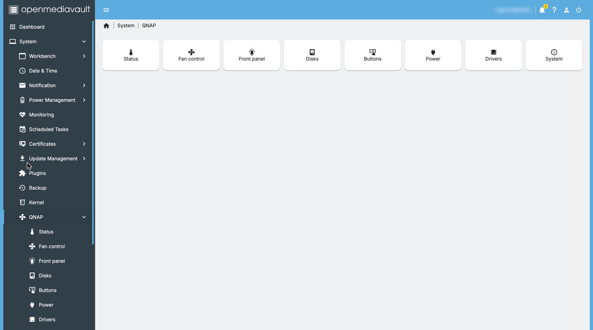

### 7.2 Set up the drivers

The plugin needs two small open source drivers to talk to the QNAP
hardware. One click installs them.

1. Go to **System > QNAP > Drivers**.
2. Click **Set up drivers**.
3. Wait. This installs the hardware drivers and everything they need to
   build for your system, then turns on fan control. It takes **a few
   minutes**. Leave the page open until it finishes.
4. When it's done, the page shows the **qnap8528 driver** as loaded (and
   the QM2 driver too, if you have a QM2 card).

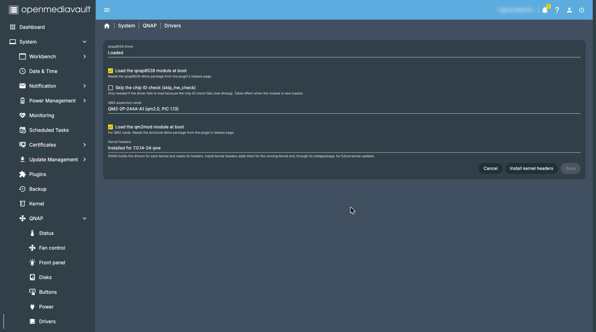

You should hear the fans settle down from full speed to a quieter
speed within a minute.

### 7.3 Check and adjust

1. **System > QNAP > Status** shows each fan's speed and every
   temperature, live.
   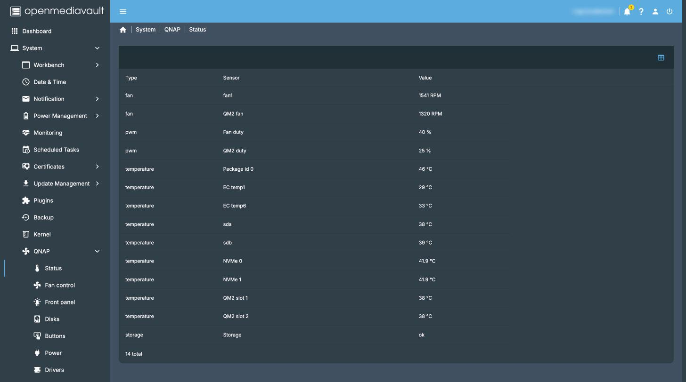
2. **System > QNAP > Fan control** lets you pick **Quiet**, **Normal** or
   **Performance**, like QTS Smart Fan, or **Custom** to set your own
   temperatures. Normal is a good start. Click **Save**, then **Apply** in
   the yellow bar.
   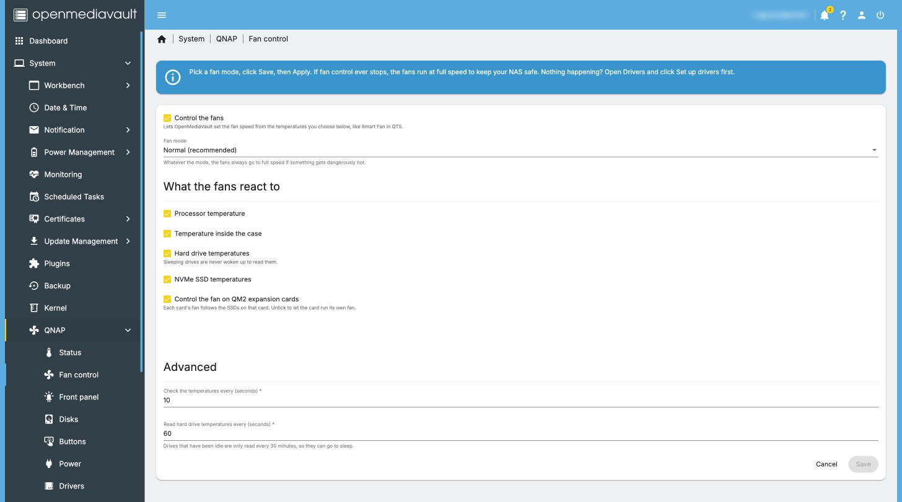
3. **System > QNAP > Power** has the QTS power options: what to do after
   a power cut, and EuP mode. Leave *Use the EFI reboot method* on: many
   QNAP models hang on restart under Linux without it. It takes effect
   after the next restart.
   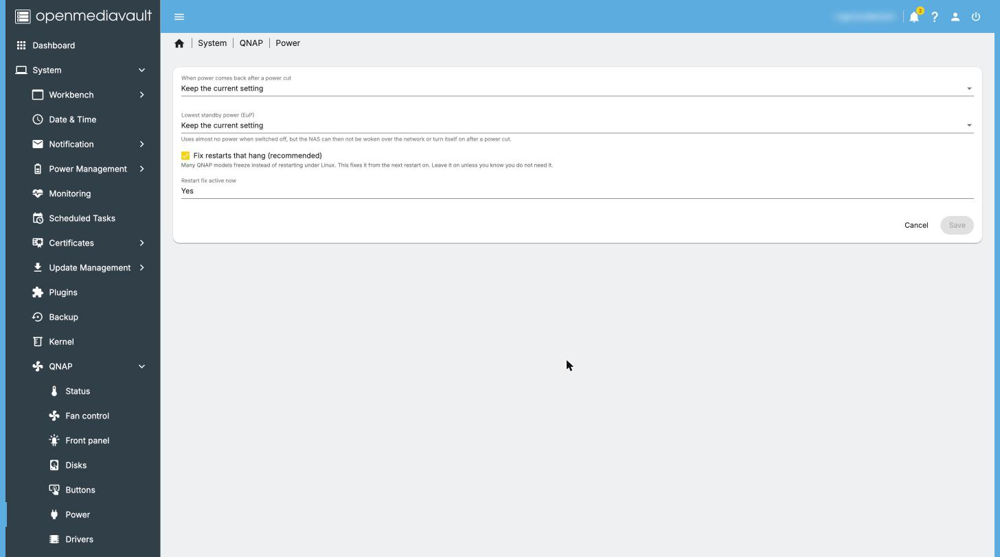
4. **System > QNAP > System** shows your model, BIOS and firmware
   versions.

---

## 8. Set up your storage and shares

This is plain OMV, not part of the plugin. The steps below are the
short version; the [OMV documentation](https://docs.openmediavault.org/)
has the details.

**Remember: setting up storage erases the disks.** Make sure your backup
is complete first.

1. **Storage > Disks**: you should see your data disks. Select each one
   and click **Wipe** (the eraser) to clear the old QTS data.
2. Choose how to combine the disks:
   - **Storage > Software RAID** (built into OMV) for a mirror (RAID 1,
     like QTS's two-disk mirror) or RAID 5. Then create a file system on
     the RAID.
   - **ZFS** through the *openmediavault-zfs* plugin (needs omv-extras,
     step 6). ZFS is what QuTS hero uses. It needs more setup; see the
     omv-extras wiki.
   - Or a single disk with no RAID.
3. **Storage > File Systems**: click **+** (Create), pick the disk or
   RAID, choose **EXT4** (a safe default), and wait. Then make sure it is
   **mounted** (OMV offers to mount it when it finishes). Apply.
4. **Storage > Shared Folders**: click **+**, give it a name (for example
   `Photos`), pick the file system, and Save. Repeat for each share.
   Apply.
5. **Users > Users**: create a user for each person. Then give them
   access in **Storage > Shared Folders > Permissions**.
6. **Services > SMB/CIFS** (Windows and Mac file sharing):
   - **Settings**: tick **Enabled**, Save.
   - **Shares**: click **+**, pick a shared folder, Save. Apply.
7. On your computer, open `\\` and the NAS address in Windows File
   Explorer (for example `\\NAS_ADDRESS`), or in macOS Finder choose
   **Go > Connect to Server** and type `smb://` and the address. Log in
   with an OMV user.
8. Copy your data back from your backup.

**Let the disks sleep:** to have idle disks spin down, set a spindown
time in **Storage > Disks** (select a disk, edit). Some settings and
tools keep disks awake; see [Letting disks sleep](../disk-sleep.md).

---

## 9. Day to day

### See fans and temperatures

- **The dashboard** (the OMV home page): click the dashboard's settings
  to add the QNAP widgets: a fans and temperatures table, a device
  summary and round gauges.
  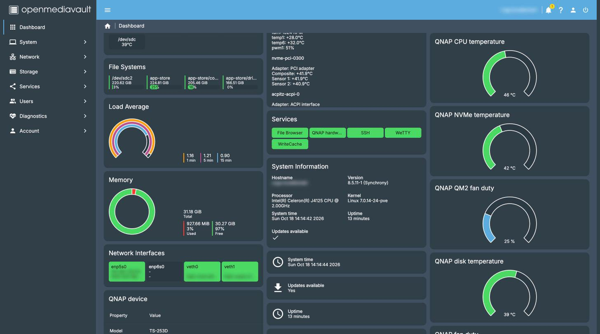
- **System > QNAP > Status** for the full list.
- **Diagnostics > Performance statistics > QNAP** for history graphs
  (by hour, day, week, month and year).
  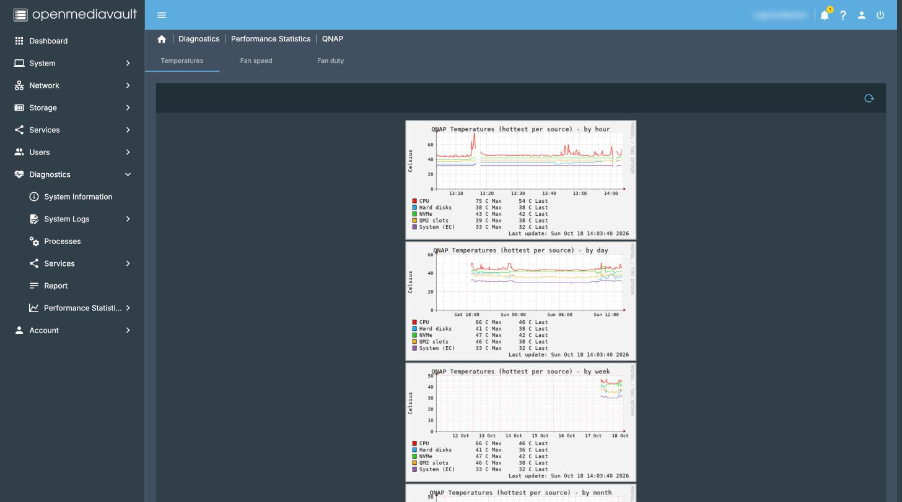

### Get email alerts

1. **System > Notification > Settings**: tick **Enabled** and fill in your
   email provider's details (SMTP server, port, user name and password,
   sender and recipient). Your email provider's help pages list these.
   Save and Apply. Use **Send test email** to check.
2. **System > Notification > Events**: make sure **QNAP hardware** is
   ticked. You then get an email when a fan stops, something gets too
   hot, a disk or pool has a problem (for more than a minute), when it
   clears, and if the fan service stops unexpectedly.
   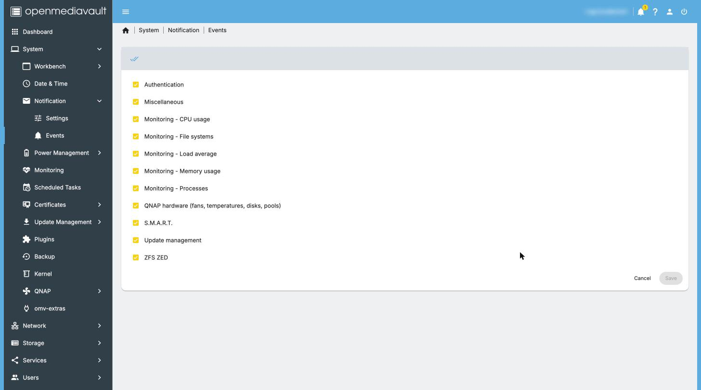

### Dim the lights at night

**System > QNAP > Front panel**: set the **LED brightness**, then tick
**Night brightness** and choose when the night starts and ends and how
bright the lights are at night. Save and Apply.

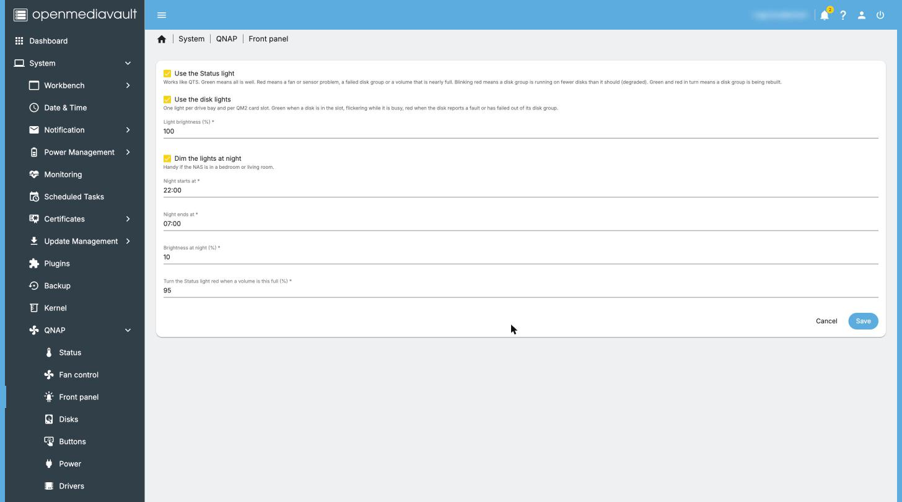

The status light works like QTS: green when all is well, red when there
is a fault, blinking red for a degraded disk array.

### Find a disk (Locate)

**System > QNAP > Disks** lists the bays. Click **Locate** on a disk and
its bay light blinks red for 10 minutes, so you pull the right tray.

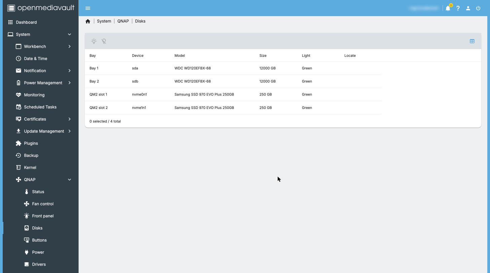

### Use the USB Copy and Reset buttons

On OMV the buttons run a task you choose.

1. First create the task in **System > Scheduled Tasks** (for example a
   copy job, or a command to shut down). You can leave it unscheduled.
2. Then go to **System > QNAP > Buttons** and pick it under **USB Copy
   button runs** (or **Reset button (hold 3 seconds) runs**).
3. Tick **Beep on events** if you want QTS-style beeps.


The Reset button no longer resets your password or network as it did in
QTS: it only runs the task you choose, if any.

### Keep up to date

- **System > Update Management** updates OMV and Debian.
- For a new plugin version, download the new `.deb` from the
  [releases page](https://github.com/nader-eloshaiker/omv-qnap-plugin/releases/latest)
  and upload it in **System > Plugins** as in step 7.

---

## 10. Going back to QTS

As long as you didn't install onto the internal flash, QTS is still
there.

1. In OMV, shut down: click the power icon at the top right, then
   **Shutdown**.
2. **Unplug the USB SSD**.
3. Turn the NAS on. With no OMV drive, it starts QTS from its internal
   flash. If it doesn't, enter the BIOS (F2 or DEL) and put the internal
   flash first in the boot order (it may be called "QNAP" or "DOM", or
   just show a small size).

**QTS can't read disks set up by OMV.** It will see them as new disks
and offer to set them up, which erases them. Copy your data off first,
just as in step 2.

To return to OMV, plug the USB SSD back in and set it first in the boot
order again (step 4.4).

---

## 11. Troubleshooting

**The fans are loud (full speed).**
This is the plugin's safety mode. Whenever the fan service is stopped,
not set up, or has crashed, the fans go to full speed on purpose, so the
NAS never overheats. Check:

1. **System > QNAP > Drivers**: is the driver loaded? If not, click
   **Set up drivers** again.
2. **System > QNAP > Fan control**: is **Enable** ticked? Save and Apply.
3. The dashboard's **Services** widget: is *QNAP hardware* running?
4. Restart the NAS. If the fans stay loud, ask for help (step 12).

**The Drivers page says a driver is missing or not loaded.**

1. Click **Set up drivers** and wait for it to finish.
2. If it fails, check that the NAS can reach the internet (System >
   Update Management should be able to check for updates).
3. After a big system update (a new Linux kernel), the drivers are
   rebuilt automatically when the NAS restarts. If the page shows
   missing **kernel headers**, click **Install kernel headers**, then
   restart.
4. Your model may not be supported by the driver yet. Check the
   [qnap8528 model list](https://github.com/0xGiddi/qnap8528) and ask.

**The NAS hangs when restarting.**
Many QNAP models do this under Linux. Leave **System > QNAP > Power >
Use the EFI reboot method** on and restart once more (holding the power
button to turn it off if needed). Before the plugin is installed, use
Shutdown and turn it back on instead of Restart.

**The disks never go to sleep.**
See [Letting disks sleep](../disk-sleep.md). The plugin itself never
wakes a sleeping disk, but some OMV settings and other tools do.

**I can't find the NAS on the network.**
Look at the monitor on the NAS: the address is usually shown above the
login prompt. Or check your router's list of connected devices. If the
network settings are wrong, log in at the NAS as `root` and run
`omv-firstaid` (an OMV menu that resets the network and web page
settings).

**I forgot the web page password.**
Log in at the NAS as `root` and run `omv-firstaid`; it can reset the web
administrator password.

**The NAS starts QTS instead of OMV.**
The boot order changed, or the USB SSD isn't plugged in. See step 4.4.

---

## 12. Getting help

- **The OMV forum thread for this plugin:**
  [openmediavault-qnap: fan control, LEDs and hardware settings for QNAP NAS](https://forum.openmediavault.org/index.php?thread/59641-openmediavault-qnap-fan-control-leds-and-hardware-settings-for-qnap-nas-omv-8-te/).
  Questions about installing OMV in general are welcome on the
  [OMV forum](https://forum.openmediavault.org/) too.
- **Bugs and feature requests:**
  [GitHub issues](https://github.com/nader-eloshaiker/omv-qnap-plugin/issues).
  Say which QNAP model you have and what **System > QNAP > System** and
  **Drivers** show. Please blur serial numbers in screenshots.
- **Testing another model?** A [model test report](../testing/model-testing.md)
  is the best way to get your model supported.

This project is not affiliated with QNAP. Use at your own risk, and keep
backups.

---

## Sources

- OpenMediaVault documentation:
  [installation from ISO](https://docs.openmediavault.org/en/latest/installation/via_iso.html),
  [installation (default web login)](https://docs.openmediavault.org/en/latest/installation/index.html),
  [system requirements](https://docs.openmediavault.org/en/latest/prerequisites.html)
- [openmediavault.org download page](https://www.openmediavault.org/download.html)
- [omv-extras wiki](https://wiki.omv-extras.org/) and its
  [install script](https://github.com/OpenMediaVault-Plugin-Developers/packages/blob/master/install)
- QNAP: [Updating the BIOS on a QNAP NAS](https://www.qnap.com/en-uk/how-to/tutorial/article/updating-the-bios-on-a-qnap-nas)
  (F2/DEL for BIOS setup, F7 for boot options on UEFI models, USB keyboard
  and HDMI monitor)
- QNAP community: [TS-451+: Unable to access boot menu](https://community.qnap.com/t/ts-451-unable-to-access-boot-menu/1124)
  (keyboard and cold-boot tips)
- [qnap8528 driver](https://github.com/0xGiddi/qnap8528) (supported models)
- This project: [tested models](../hardware/models.md),
  [the reference TS-253D](../hardware/ts-253d.md),
  [letting disks sleep](../disk-sleep.md)
